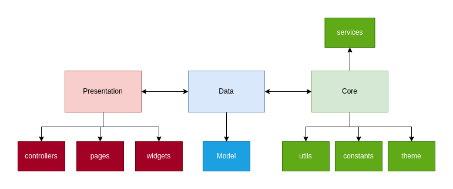
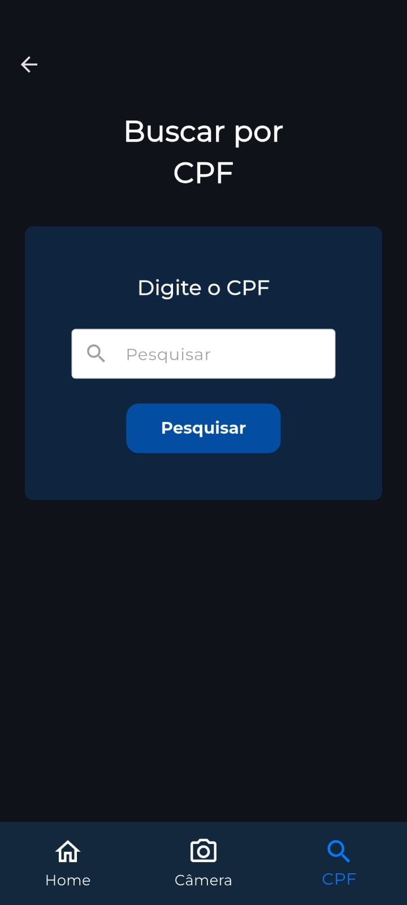
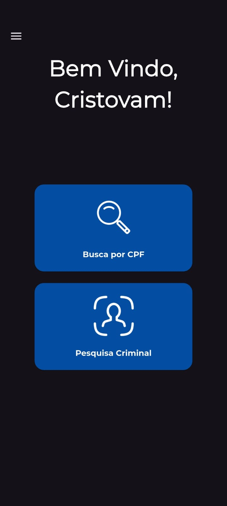
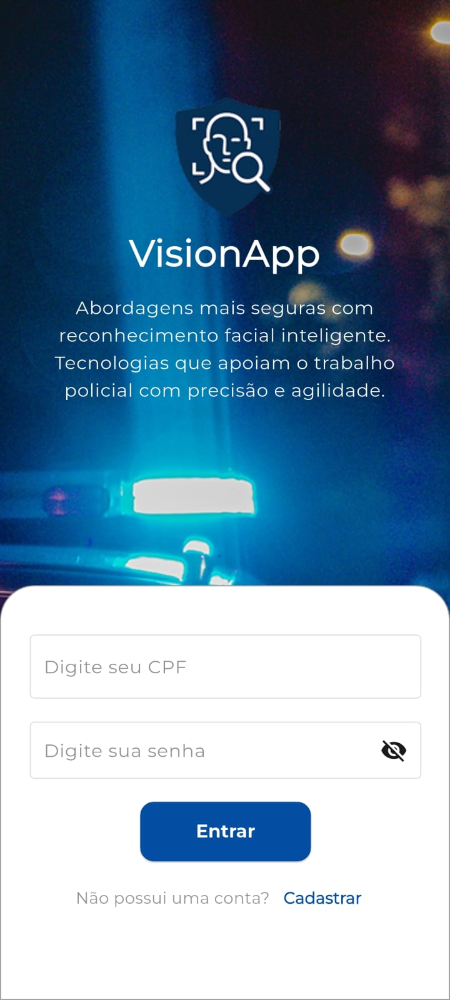
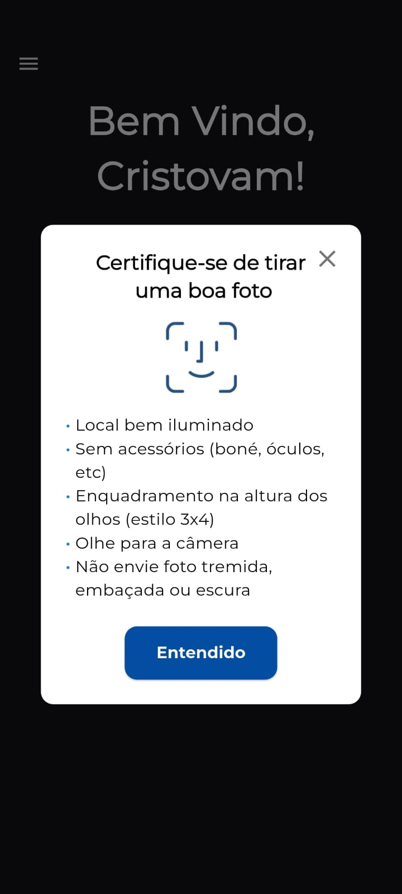
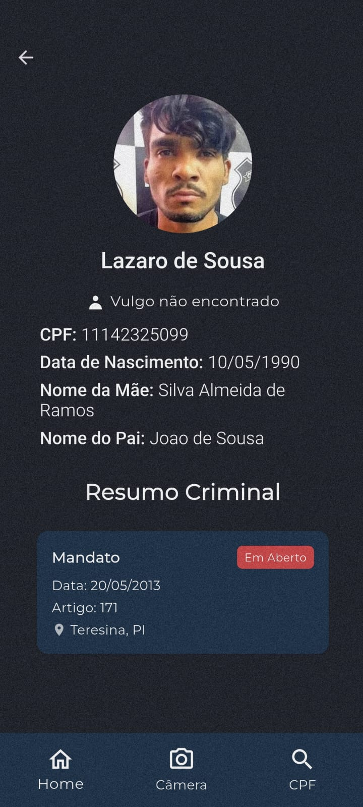

<h1 align="center"> VisionApp - Mobile </h1>

<div align="center">


</div>


## Sumário

* [Integrantes](#integrantes)
* [Descrição](#descrição)
* [Requisitos](#requisitos)
* [Tecnologias](#tecnologias)
* [Fluxo do Software](#fluxo-do-software)
* [Funcionalidades](#funcionalidades)
* [Como Executar](#como-executar)
* [CI e Qualidade](#ci-e-qualidade)
* [Dificuldades](#dificuldades)
* [Resultados](#resultados)
* [Conclusao](#conclusao)

## Integrantes

- Anderson do Vale - [and3510](https://github.com/and3510) 
- Beatriz Barreto - [whosbea](https://github.com/whosbea)
- Cristovam Paulo - [cristovam10000](https://github.com/cristovam10000)
- Gustavo do Vale - [gustavodovale](https://github.com/gustavodovale)
- Lucas Cesar

## Descrição

Desenvolvimento de um aplicativo de segurança pública que utiliza reconhecimento facial baseado em IA para identificação de indivíduos durante abordagens policiais. O sistema compara a imagem capturada com um banco de dados oficial e exibe informações como nome, CPF e pendências judiciais. Caso haja mandado de prisão ativo, o aplicativo alerta o policial, agilizando a tomada de decisão.

O aplicativo consome a [VisionApp - API](https://github.com/visionapp-projeto/visionapp-app-api), responsável pelo reconhecimento facial e pela consulta das fichas criminais. O login é feito via **Keycloak** (OIDC + PKCE).


## Requisitos


### **1. Captura de Imagem**  
- Permitir a captura de imagem em tempo real via câmera do dispositivo móvel.  
- Processar a imagem capturada para extração das características faciais.  

### **2. Processamento e Reconhecimento Facial**  
- Identificar pontos-chave do rosto para comparação com registros armazenados.  
- Realizar a correspondência entre a imagem capturada e as fotos cadastradas no banco de dados.  

### **3. Consulta e Validação da Identidade**  
- Consultar o banco de dados e validar a identidade do indivíduo.  
- Recuperar e exibir as seguintes informações em caso de correspondência:  
  - Nome completo  
  - Nome da mãe  
  - CPF  

### **4. Verificação de Pendências Judiciais**  
- Verificar automaticamente se há registros de busca ou mandados de prisão ativos.  
- Realizar a consulta de forma automática e em tempo real.  

### **5. Exibição de Resultados**  
- Exibir a confirmação da identidade na interface do usuário.  
- Gerar um alerta para o policial caso haja alguma pendência judicial.  

### **6. Segurança e Privacidade**  
- Restringir o acesso ao sistema apenas a usuários autorizados.  
- Registrar todas as consultas para fins de auditoria e segurança.  
- Garantir que o armazenamento e processamento das informações sigam normas de proteção de dados.  


## Tecnologias

- Dart
- Flutter 3.35
- Keycloak (OIDC + PKCE)
- Google ML Kit (detecção facial, via `face_camera`)
- SonarQube

### Pacotes principais

- **flutter_web_auth_2** + **crypto** – Login no Keycloak com Authorization Code + PKCE.
- **face_camera** / **google_mlkit_face_detection** – Câmera com detecção de rosto em tempo real.
- **http** – Comunicação com a API.
- **shared_preferences** – Armazenamento local dos tokens.

## Fluxo do Software

<div align="center"> 



</div>

## Funcionalidades

### Back-End (API)
- Validação do token JWT emitido pelo Keycloak
- Reconhecimento facial a partir da foto enviada (`POST /buscar-similaridade-foto/`)
- Consulta de identidade e ficha criminal por CPF (`POST /buscar-ficha-criminal/`)
- Registro de cada consulta com a matrícula do policial

### Front-End (App Flutter)
- Login com Keycloak (OIDC + PKCE), com renovação automática do token
- Perfil do policial no menu lateral (nome, cargo, classe e matrícula, obtidos do Keycloak)
- Logout que encerra a sessão no Keycloak
- Orientações de captura antes do scanner (iluminação, sem acessórios, enquadramento 3x4)
- Scanner de rosto com detecção em tempo real e envio da imagem para a API
- Tratamento dos resultados do reconhecimento: identidade confirmada, lista de possíveis identidades (resultado ambíguo) e "nada consta"
- Pesquisa por CPF
- Visualização da ficha criminal, com destaque para mandados em aberto e foragidos


## Como Executar

Requer Flutter 3.35 e um dispositivo ou emulador Android.

```bash
flutter pub get
flutter run
```

Os endereços da API e do Keycloak ficam em `lib/core/constants/api_constants.dart` (`ApiConstants.baseUrl` e `keycloakConstants`). O redirect do login usa o esquema `com.visionapp://callback`, que precisa estar cadastrado como *Valid Redirect URI* no client do Keycloak.

## CI e Qualidade

Em todo pull request para `develop` ou `main`, o GitHub Actions instala o Flutter, resolve as dependências e envia a análise do código (`lib/`) ao SonarQube.

## Dificuldades

- Integração com API
- Configuração da Camera no Aplicativo
- Configuração da Detecção do Rosto pela Camera
- Organização da arquitetura do aplicativo


## Resultados

<div align="center"> 

<p float="left">
  
  
  
</p>

<p float="left">
  
  
  
</p>

</div>


## Conclusao


O VisionApp - Mobile foi desenvolvido com o objetivo específico de auxiliar agentes de segurança na identificação de indivíduos com pendências judiciais. Diferente de sistemas de vigilância em massa, o aplicativo é voltado exclusivamente para uso em abordagens policiais, onde há a necessidade de verificação rápida e precisa da identidade de pessoas em conflito com a lei.

Com a integração de reconhecimento facial baseado em IA e um banco de dados oficial, o aplicativo permite capturar a imagem de um suspeito, compará-la com registros existentes e, em caso de correspondência, exibir informações como nome, CPF e eventuais mandados de prisão ativos. Essa resposta em tempo real aumenta a agilidade das ações policiais e reduz os riscos envolvidos nas abordagens.

Além disso, o VisionApp reforça o compromisso com a privacidade e a legalidade, ao restringir o uso do sistema apenas a profissionais autorizados e registrar todas as consultas para fins de auditoria. O projeto apresenta resultados promissores e tem potencial para evoluir como uma ferramenta estratégica no combate à criminalidade.
